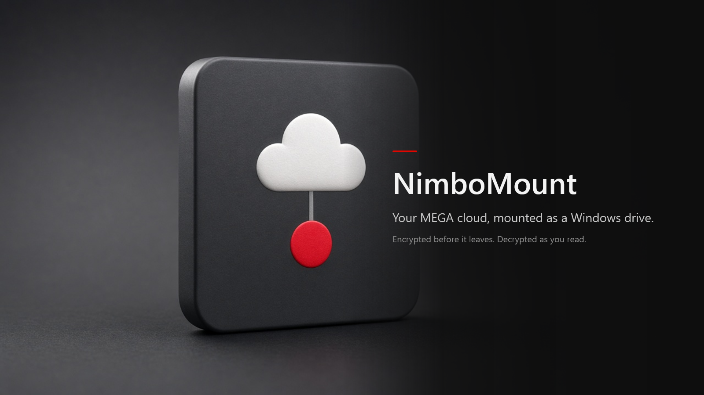
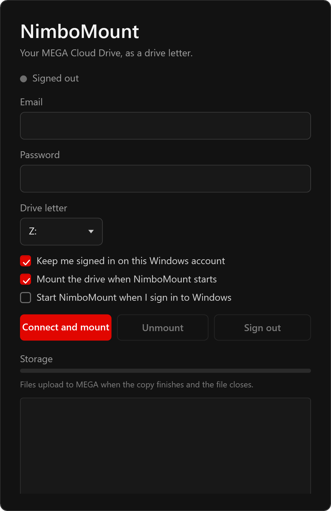
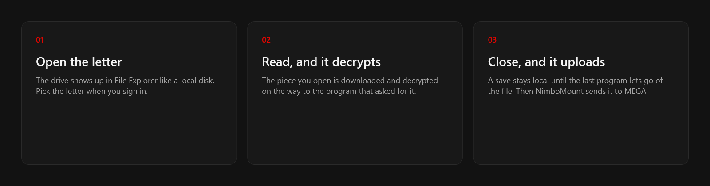

<p align="center">
  
</p>

NimboMount puts your MEGA cloud on a drive letter. Open it in File Explorer, copy a file onto it, and the file is encrypted before it leaves the machine. Open a file, and it is decrypted as you read it.

NimboMount talks to MEGA directly.

<p align="center">
  
</p>

<p align="center">
  
</p>

## Install

| | |
| --- | --- |
| Windows | 64-bit |
| [WinFsp](https://winfsp.dev/rel/) | Creates the drive letter. Install this first. |

Run the setup:

```text
dist\NimboMount-Setup.msi
```

Setup asks for administrator approval and installs NimboMount for every account on the PC.

- `C:\Program Files\NimboMount`
- A Start menu shortcut
- An uninstall entry in Windows Settings
- The .NET runtime, included in the setup

WinFsp stays a separate install. If it is missing, NimboMount opens the download page.

Build the installer from source:

```powershell
dotnet build installer\NimboMount.wixproj -c Release
```

## Sign in

1. Open NimboMount.
2. Enter the MEGA email and password.
3. Pick a drive letter. The letter in the box is the one that will be mounted.
4. Choose **Connect and mount**.

If the account uses an authenticator, the code box appears after the first attempt.

| Option | What it does |
| --- | --- |
| Keep me signed in on this Windows account | Saves the session for this Windows user. The password is not saved. |
| Mount the drive when NimboMount starts | Mounts the letter as soon as the app opens. |
| Start NimboMount when I sign in to Windows | Launches into the tray at sign-in. Off until you turn it on. |

**Sign out** removes the saved session.

## While it is running

Closing the window leaves the drive mounted. NimboMount stays in the system tray.

| Tray | |
| --- | --- |
| Open | Brings the window back. |
| Unmount | Removes the drive letter. Files still waiting are uploaded first. |
| Exit | Uploads anything still waiting, then quits. |

The letter exists only while NimboMount is running.

## On the drive

The root of the volume is your Cloud Drive. Inbox and Rubbish Bin stay hidden. Shared folders that can be opened appear at the root.

| Action | What happens |
| --- | --- |
| Open a file | The piece you read is downloaded, decrypted, and cached. |
| Save a file | The local copy is written first. The upload starts when the last program closes the file. |
| New folder | The folder is created in the cloud immediately. |
| Rename or delete | The change is sent to MEGA. |

Downloads are cached under `%LOCALAPPDATA%\NimboMount\blocks`. A file that was still uploading when the app closed is finished the next time the drive mounts.

Names Windows cannot store, such as `CON` or a name that ends with a space, are shown with a safe stand-in so the file still appears.

## Privacy

The saved session is protected with Windows DPAPI and can be read only by the same Windows user. NimboMount does not keep the password.

A saved session can open files whose keys are protected by the account master key. A file whose key is wrapped with the account RSA key needs a password sign-in again.

The log is `%LOCALAPPDATA%\NimboMount\nimbo.log`.

## Build a loose copy

This copy needs the [.NET 10 Desktop Runtime](https://dotnet.microsoft.com/download/dotnet/10.0) and WinFsp.

```powershell
dotnet publish src\NimboMount.App\NimboMount.App.csproj -c Release -r win-x64 --self-contained false -o dist
```

Start `dist\NimboMount.exe`.

## Limits

- A very large copy finishes its upload before Explorer reports that the copy is done.
- MEGA replaces a whole file. There is no partial write to an existing cloud file.
- Nodes whose keys cannot be opened are left out of the drive.
